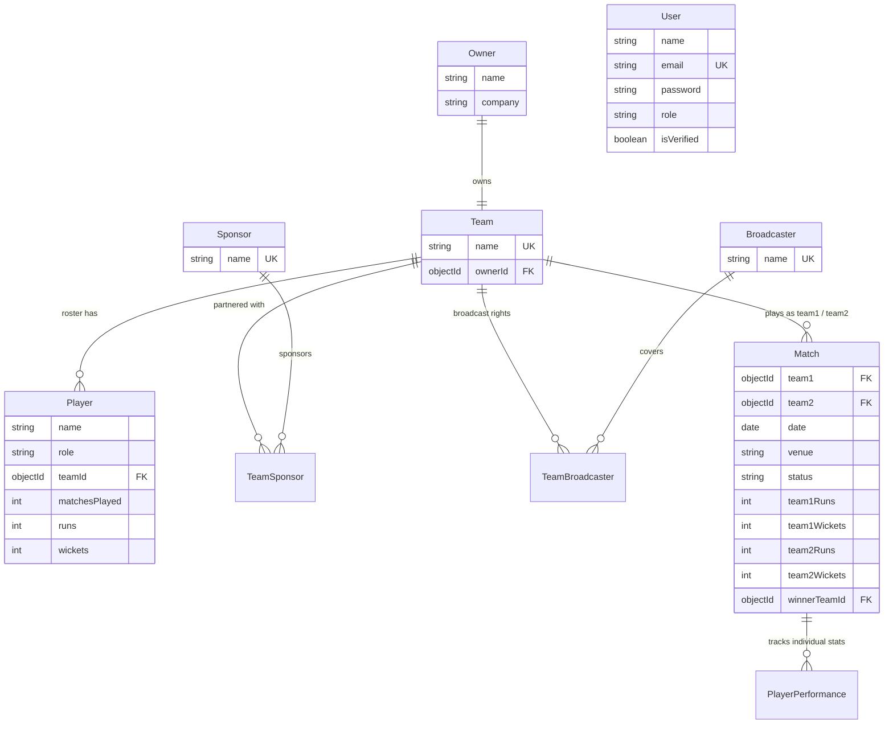

# 🏏 IPL Management System — REST API Backend

[](https://nodejs.org/)
[](https://expressjs.com/)
[](https://www.mongodb.com/)
[](https://jwt.io/)
[](https://www.docker.com/)

A production-grade, modular **IPL (Indian Premier League) Management System** backend built with **Express 5**, **MongoDB (Mongoose)**, and custom **JWT Authentication**.

This system manages the entire operational lifecycle of an IPL tournament: franchise owners, teams, player rosters, multi-sponsor partnerships, broadcasting networks, match scheduling, and match result processing with automatic player career statistics aggregation.

---

## 🏛️ System Architecture & Entity Relationships



---

## ✨ Core Features

1. **Custom Authentication & Authorization Layer**:
   - Secure registration, login, and token issuance using **bcryptjs** and **jsonwebtoken**.
   - Dual-token flow: short-lived JWT **access tokens** and persistent **refresh tokens** stored as hashes.
   - Mailtrap-powered background email verification and expiring password reset tokens.
   - Profile avatar upload directly using in-memory Multer buffer and ImageKit.

2. **Franchise & Team Management**:
   - Create, list, update, and delete IPL teams linked to specific franchise owners.
   - Referential integrity protections: Teams cannot be deleted if active players are currently signed.

3. **Player Roster & Transfer Engine**:
   - Manage players with specialized roles: `batsman`, `bowler`, `all-rounder`, `wicket-keeper`.
   - **Player Transfer API**: Transfer players between franchises cleanly (`PATCH /api/players/:id/transfer`).
   - Leaderboard endpoints: Top run scorers (`/api/players/top`) and top wicket takers (`/api/players/top-wickets`).

4. **Multi-Sponsor & Broadcaster Networks**:
   - Normalized junction models (`TeamSponsor` and `TeamBroadcaster`) with compound indexes preventing duplicate partner assignments.
   - Attach, inspect, and detach sponsors/broadcasters per franchise.

5. **Match Fixtures & Live Result Aggregation**:
   - Schedule upcoming matches with venue, date, and participating teams (`GET /api/matches/schedule`).
   - **Automated Stat Engine**: When a match result is saved (`PATCH /api/matches/:id/result`), the system marks the match completed, records scores, identifies the winner, and automatically increments each player's career `matchesPlayed`, `runs`, and `wickets`.

---

## 📡 API Reference

All IPL operations (`/api/teams`, `/api/players`, `/api/matches`, etc.) require an `Authorization: Bearer <access_token>` header.

### 🔐 1. Authentication Endpoints (`/api/auth`)

| Method | Endpoint | Auth | Description |
|---|---|---|---|
| `POST` | `/api/auth/register` | None | Register new user account |
| `POST` | `/api/auth/login` | None | Login & receive JWT access token |
| `GET` | `/api/auth/verify-email/:token` | None | Verify account email address |
| `POST` | `/api/auth/refresh-token` | None | Refresh expired access token |
| `GET` | `/api/auth/me` | Bearer | Current user profile |
| `POST` | `/api/auth/logout` | Bearer | Logout and clear session cookies |
| `POST` | `/api/auth/avatar` | Bearer | Upload profile avatar |

---

### 🏢 2. Franchise Owners (`/api/owners`)

| Method | Endpoint | Description |
|---|---|---|
| `POST` | `/api/owners` | Register franchise owner (`name`, `company`) |
| `GET` | `/api/owners` | List all franchise owners |
| `GET` | `/api/owners/:id` | Get owner details |
| `PUT` | `/api/owners/:id` | Update owner details |
| `DELETE` | `/api/owners/:id` | Delete owner record |

---

### 🛡️ 3. Teams (`/api/teams`)

| Method | Endpoint | Description |
|---|---|---|
| `POST` | `/api/teams` | Create new team (`name`, `ownerId`) |
| `GET` | `/api/teams` | List all teams with owner details |
| `GET` | `/api/teams/:id` | Get team by ID |
| `PUT` | `/api/teams/:id` | Update team |
| `DELETE` | `/api/teams/:id` | Delete team (guarded against assigned players) |
| `GET` | `/api/teams/:id/players` | Get full player roster for a team |
| `POST` | `/api/teams/:id/sponsors` | Attach sponsor to team (`{ "sponsorId": "..." }`) |
| `GET` | `/api/teams/:id/sponsors` | List all sponsors of a team |
| `DELETE` | `/api/teams/:id/sponsors/:sponsorId` | Detach sponsor from team |
| `POST` | `/api/teams/:id/broadcasters` | Assign broadcaster to team (`{ "broadcasterId": "..." }`) |
| `GET` | `/api/teams/:id/broadcasters` | List all broadcasters of a team |
| `DELETE` | `/api/teams/:id/broadcasters/:broadcasterId` | Unassign broadcaster from team |

---

### 🏏 4. Players (`/api/players`)

| Method | Endpoint | Description |
|---|---|---|
| `POST` | `/api/players` | Register player (`name`, `role`, `teamId`) |
| `GET` | `/api/players` | List all players |
| `GET` | `/api/players/top` | Leaderboard: Top run scorers |
| `GET` | `/api/players/top-wickets` | Leaderboard: Top wicket-takers |
| `GET` | `/api/players/team/:teamId` | Get players belonging to a team |
| `GET` | `/api/players/:id` | Get player profile and stats |
| `PATCH` | `/api/players/:id/transfer` | Transfer player to a new team (`{ "newTeamId": "..." }`) |
| `PATCH` | `/api/players/:id/role` | Update player role (`{ "role": "all-rounder" }`) |
| `DELETE` | `/api/players/:id` | Delete player |

---

### 🏆 5. Matches & Results (`/api/matches`)

| Method | Endpoint | Description |
|---|---|---|
| `POST` | `/api/matches` | Schedule match (`team1`, `team2`, `date`, `venue`) |
| `GET` | `/api/matches` | List all matches |
| `GET` | `/api/matches/schedule` | Upcoming scheduled matches sorted by date |
| `GET` | `/api/matches/team/:teamId` | Matches involving a specific team |
| `GET` | `/api/matches/:id` | Get match details and scorecard |
| `PATCH` | `/api/matches/:id/result` | Record final scorecard & update player statistics |
| `DELETE` | `/api/matches/:id` | Delete match record |

---

### 🤝 6. Sponsors & Broadcasters

* **Sponsors**: `POST /api/sponsors`, `GET /api/sponsors`, `GET /api/sponsors/:id`, `DELETE /api/sponsors/:id`
* **Broadcasters**: `POST /api/broadcasters`, `GET /api/broadcasters`, `GET /api/broadcasters/:id`, `DELETE /api/broadcasters/:id`

---

## 🚀 Getting Started

### 1. Clone & Install
```bash
git clone https://github.com/dev-ops-om/IPL-management-system.git
cd IPL-management-system
npm install
```

### 2. Environment Variables Setup
Copy `env.example` to `.env`:
```bash
cp env.example .env
```
Fill in your configuration (MongoDB connection string, JWT secrets, etc.).

### 3. Start Local MongoDB (Docker)
```bash
docker compose up -d
```
*Maps local MongoDB on port `27018` with user `admin` and password `password`.*

### 4. Run Development Server
```bash
npm run dev
```
The server will boot on `http://localhost:8080`.

### 5. Automated End-to-End Test Suite
Run the built-in end-to-end simulation script:
```bash
npm run test:ipl
```

---

## 👨‍💻 Author

**Om Shirbhate** — [@dev-ops-om](https://github.com/dev-ops-om)
